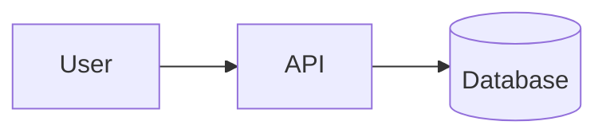

# CLAUDE.md

Context and guidelines for Claude when working in this repo.

## Project

- **What**: Nicolas Borson's personal website at https://borson.fr — homepage, tech blog
- **Stack**: [Astro](https://astro.build) 6 + [astro-theme-pure](https://github.com/cworld1/astro-theme-pure)
  (template copied into the repo; the theme components come from the `astro-pure` npm package)
- **Package manager**: bun (`bun.lock`)
- **Hosting**: GitHub Pages, auto-deployed from `master` via `.github/workflows/deploy.yml`
- **Language**: English content (`locale` in `src/site.config.ts`)

## Layout

| Path | Content |
|---|---|
| `src/site.config.ts` | Title, author, menu, footer social links, integrations |
| `src/pages/index.astro` | Homepage (intro, latest posts) |
| `src/pages/about/index.astro` | About page (full intro) |
| `src/content/blog/` | Blog posts (Markdown / MDX), one folder per post |
| `public/playground/` | Personal vibe-coded games, served as-is at `/playground/` — **unlisted**: never link it from the site (menu, home, posts) |
| `src/assets/avatar.jpg` | Profile picture (homepage); `public/images/social-card.jpg` is cut from the same photo |
| `public/favicon/favicon.svg` | "NB" monogram; the PNGs next to it are rasterized from it (16/32/180/192/512) |
| `src/components/Mermaid.astro` | Draws ```` ```mermaid ```` blocks in posts: neo look, Nord palette, light/dark |

## Adding a blog post

Create `src/content/blog/<slug>/index.md` (folder form, so images can sit next to the post) or
`src/content/blog/<slug>.md`. The slug becomes the URL: `/blog/<slug>`. Kebab-case, lowercase.

```yaml
---
title: 'Post title'            # required, max 60 chars
description: 'One-line summary' # required, max 200 chars (meta description, RSS; Google truncates ~160)
publishDate: 2026-10-19         # required
updatedDate: 2026-10-20         # optional
tags: ['homelab', 'docker']     # lowercase, quoted
heroImage: { src: './cover.jpg', alt: 'What the image shows' } # optional, path relative to the post
draft: false                    # true = only visible in dev
---
```

Schema lives in `src/content.config.ts`; the build fails on invalid frontmatter. Code blocks get
syntax highlighting, copy button and collapse automatically (Shiki, `astro.config.ts`).

## Diagrams

Write diagrams as ```` ```mermaid ```` code blocks in the post. They are rendered in the browser by
`src/components/Mermaid.astro` (loaded on blog posts only, mermaid itself is fetched only when a post
has a diagram) and redrawn when the reader toggles the theme. No image to export, nothing to commit
besides the Markdown.

Art direction, applied automatically, never restyled per diagram:

- **Look**: mermaid `neo` (rounded cards, 1.5px borders, soft shadow), Satoshi 15px like the body text.
- **Colors**: [Nord](https://www.nordtheme.com). Default nodes are white (light) / nord1 (dark) with a
  Frost border; edges Polar Night / Snow Storm. The palette lives in `PALETTE` in the component:
  change it there, nowhere else.
- **Emphasis** (flowcharts, state diagrams): `node:::hl` = Aurora red, the thing the paragraph is
  about (one or two nodes at most); `node:::alt` = Aurora yellow, a secondary contrast. No `style`,
  `classDef`, `%%{init}%%` or hex colors in posts: they would break dark mode or the palette.
- **Charts**: series colors go Frost, Aurora red, yellow, green, in that order. Put the series the
  paragraph is about first or second.

Pick the type from what the paragraph says, not by default:

| The text describes | Use | Example in the posts |
|---|---|---|
| A process, a loop, who decides what | `flowchart` | the delivery chain, the reviewer-fix loop |
| Two criteria that split cases into four | `quadrantChart` | trust levels (verify × undo) |
| A few figures to compare | `xychart` (bars) | Faros AI adoption numbers |
| A share of a whole (2–4 parts), every part named by the source | `pie` | |
| Messages between actors over time | `sequenceDiagram` | |
| Dates, phases | `timeline` / `gantt` | |

`gitGraph` renders badly here (rotated labels, overlapping tags): use a flowchart for commits.

Rules:

- Always start with `accTitle:` and `accDescr:` (screen readers; the description should say what
  the diagram shows, not repeat the labels).
- Short labels (1–3 words, `<br/>` for a second line). The diagram illustrates the text next to it,
  it does not replace it.
- Charts plot only what the source states, with its wording. Never derive a complement ("the other
  41% must be…") or relabel a figure: check the number against the linked source first.
- Keep diagrams small: about 4–5 nodes per row, only what the paragraph argues. Phones shrink them to
  60% then scroll horizontally; past that, use `TD` or split.
- Check both themes and a narrow viewport in `bun run dev` before publishing.



## Playground

Each game is plain HTML/JS in `public/playground/<game>/index.html`, listed in
`public/playground/index.html`. Every page carries `<meta name="robots" content="noindex">`: keep it
on new games. Links inside the playground **must be relative**
(`href="multiplication/"`, not `/multiplication/`) or they escape the `/playground/` prefix.

## Local dev

No Node on the host: run bun in Docker from the repo root.

```bash
docker run --rm -it -u $(id -u):$(id -g) -e HOME=/tmp -v $PWD:/app -w /app oven/bun:1 bun install
docker run --rm -it -u $(id -u):$(id -g) -e HOME=/tmp -p 4321:4321 -v $PWD:/app -w /app oven/bun:1 bun run dev
docker run --rm -it -u $(id -u):$(id -g) -e HOME=/tmp -v $PWD:/app -w /app oven/bun:1 bun run build
```

`bun run build` = `astro-pure check` + `astro check` (type errors fail the build) + `astro build` → `dist/`.
CI runs the same command, so a green local build means a green deploy.

After deleting or renaming a post, a local build can fail with `ImageNotFound` / missing file: the
content cache still references it. Run `bun run clean` (CI always starts clean).

## Deploy

Push to `master` → GitHub Actions builds and publishes to Pages. The custom domain `borson.fr` is set
in the repo's Pages settings (no `CNAME` file needed with Actions-based deploys).

URLs have no trailing slash (`trailingSlash: 'never'`, `build.format: 'file'` → `about.html`), so
GitHub Pages serves `/about` directly. Exception: `/playground/` is a static folder.

## Conventions for Claude

- **Commits**: short conventional style (`feat:`, `fix:`, `chore:`, `content:`). No co-author trailers,
  no "Generated with Claude Code" footers.
- Keep the theme's structure; customize through `src/site.config.ts` and the pages before touching
  layouts.
- Run `bun run build` before pushing: it is the only check.
