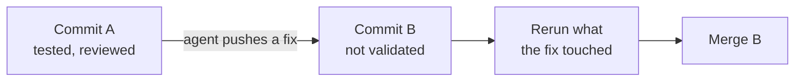
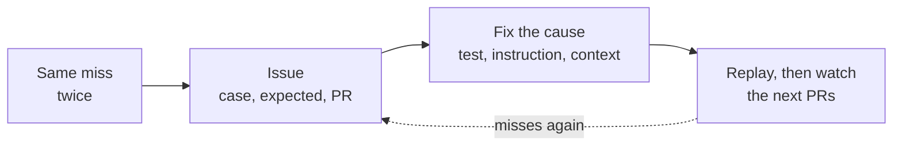

There is a failure mode that comes up in almost every account I read from teams running AI reviewers at scale. The reviewer leaves a comment. The comment is correct. The author accepts the suggested fix. The fix is wrong.

Wrong in the quiet way, the kind that passes CI and gets merged.

I have no number on how often it happens on our side. As a manager I am rarely the one reading the diff, and that is precisely why I want the habit written down before we lean on these tools. If the people who do read the diff have a checklist, I never need to.

## A small example

[Florian Bruniaux](https://florian.bruniaux.com) showed one in his talk "Du code au merge" at Dev With AI in Paris on October 12, from a real PR on his codebase at Méthode Aristote. A test covered two failure cases, a missing document and a forbidden access, and asserted only that each one raised an error. The reviewer flagged it: the test accepts any error, so it can pass for the wrong reason. Correct diagnosis.

The bot's suggested fix was to assert the same error message in both cases. More precise than before, and still incorrect, because the two cases should produce different errors. The right fix was to assert the error specific to each case, then rerun.

Three steps, and the bot got two of them. Verify the problem it reports. Then verify the correction it proposes. Two separate acts, and people skip the second because the diagnosis was so convincing.

## Where the reviewer's time goes

Anthropic published numbers from their internal reviewer this month ([How the Claude Code team does code review](https://claude.dev/blog/solving-code-review-at-anthropic/)), and one of them explains why this matters at scale.

About 59 percent of what the reviewer kept flagging in later rounds was code that had been there since its first pass. Round after round, the reviewer was rarely finding new bugs. It was finding a few more old ones each time, ones it could have raised on the first pass.

One PR on their CLI went through more than fifty review rounds overnight before its author stopped it.

Their fixes are worth copying even at a tenth of the volume.

**Label the finding.** Important, Nit, or Pre-existing. A pre-existing bug deserves a ticket. Fixing it in this PR is someone else's call.

**Cap the rounds.** After three review-and-fix rounds, the reviewer stops suggesting and asks the author to reconsider the approach. After the first few passes, it reviews only the diff.

**Flag the class.** If the same mistake appears in five places, one comment that names the pattern, so the author fixes all five, including the four nobody pointed at.

**Never repeat.** A finding already posted is not posted again.

**Every finding gets an answer.** Fix it, or resolve the thread with a reason. A later commit that fixes it closes the thread automatically.

The results after those changes, on their internal PRs: the share passing after a single round went from 65 to 78 percent, and PRs needing five rounds or more dropped from 8.9 to 1.5 percent.

## Watch it work

The second half of the problem sits with the author.

Agents are good at explaining why their code works. The explanation is usually convincing and not always right. Daniel Visca at PostHog has a rule for this ([Stop being the code review bottleneck](https://newsletter.posthog.com/p/code-review-tips)): do not accept an argument that the code works when you can watch it work.

In practice that means every change ships with a way to observe it. A command to run, a request with its expected response, a screenshot, a state dump. What gets validated is the behaviour you can see. Anthropic's version is the same: the test output goes in the PR.

Which brings up the rule that Bruniaux put on one slide and that I think deserves to be printed above every merge button.

> A test that is in progress, skipped or cancelled is not a passed test.

And its sibling: a new push changes what remains to be verified. Commit A was tested and reviewed. The agent pushes a fix, now the branch is at B. A validated does not mean B validated. Before merging B, which tests must rerun, and has anyone read the diff from A to B? After every fix, rerun the tests and the reviews that the fix touched, and only those.

## When a bot gets it wrong twice

The loop closes on one more habit, and it is the cheapest one.

When a reviewer makes the same mistake twice, or misses the same case twice, look at the harness around the reviewer before you look at the PR. Bruniaux's team opens a GitHub issue for it, with the exact case, the expected result and the linked PR. Then they fix the cause, which is usually one of three things: a missing regression test, an instruction that needs sharpening, or context the reviewer did not have. Then they replay the case and watch the next few PRs.

Anthropic does the same at a larger scale. Past incident and revert PRs, confirmed by experts, form an eval set the reviewer runs against daily, and every change to the reviewer is scored against all of it. Incidents become tests for the reviewer itself.

The habit is the same at both scales. The reviewer is a piece of software your team maintains. It has bugs. You file them.

## The checklist I would hand the team

For a reviewer comment:

1. Is the problem real? Read the code before you read the comment again.
2. Is the proposed fix right? Separate question. Often no.
3. Is it in this PR's scope, or pre-existing? Pre-existing gets a ticket.
4. After the fix, which tests and which reviews need to run again?

For the reviewer:

1. Three rounds, then stop and rethink.
2. Same miss twice, file an issue against the harness.

None of this needs a product. The first checklist is a habit, the second is a label, a round counter and an issue template. That is also why I am writing it down now, before we have a reviewer running on every PR and before the first quiet bug. What it does need is a written statement of what a good finding looks like in your repo, and that is the subject of the next post.
