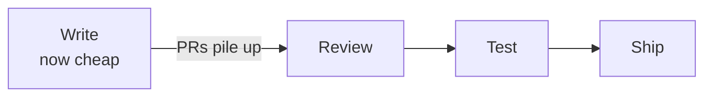
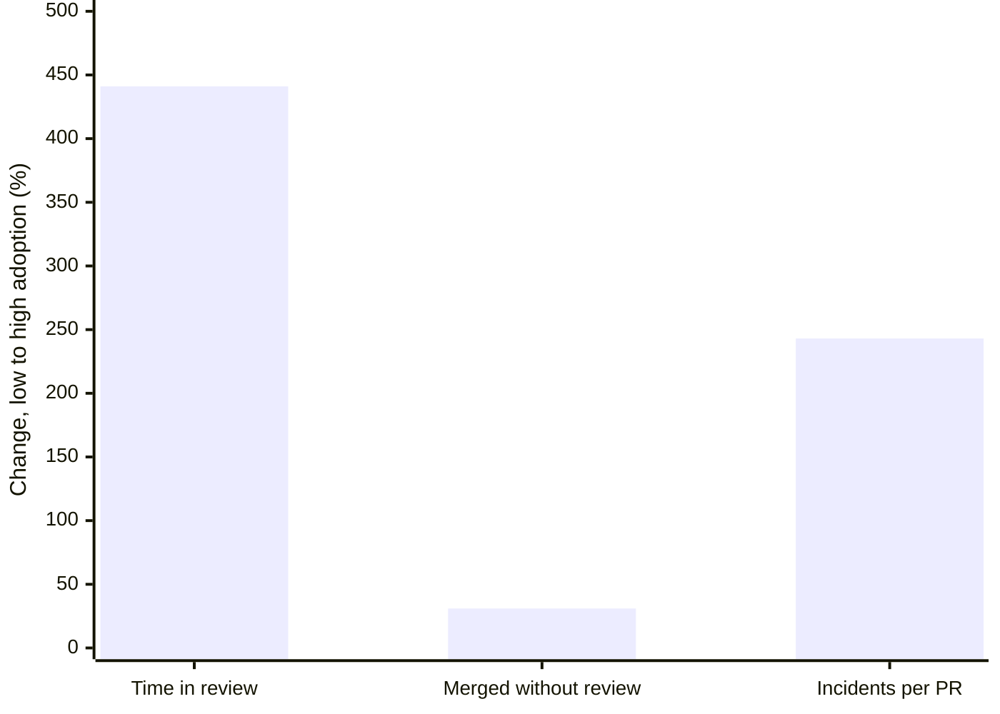
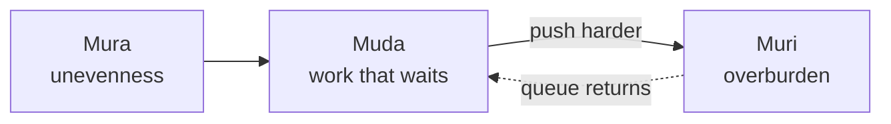

I manage a squad in a SaaS company. We adopted coding agents this year and we are at the very beginning of rethinking how we work around them. From where I sit, one thing already bothers me more than the quality of the generated code. The queue.

Pull requests arrive faster than anyone can read them. One of my engineers reviews most of the front-end work and the pile in front of him keeps growing. On a recent project we duplicated an existing integration pattern across several new data sources in a few days, because that is exactly the kind of thing an agent does well. Then we spent far longer testing it than writing it.

That is about all I have seen with my own eyes so far. Two symptoms. The rest of this post is what I found when I went looking for whether other teams had the same two, and what they did about it.

None of this is specific to us. Make one step in a chain almost free and this is what you should expect.

## When one step becomes free, the next one becomes the bottleneck

Software delivery is a chain. Specify, write, review, test, ship, observe. For twenty years the expensive step was writing. Teams, rituals and tooling were sized around that cost. Review was a fraction of the writing time, so one reviewer per author was enough. Manual QA could keep up with the trickle of features.

Now writing is wide, and review and testing kept their old width. The bottleneck is still there. It moved one step to the right.

The numbers are consistent across sources that do not share an agenda. The [2025 DORA report](https://cloud.google.com/blog/products/ai-machine-learning/announcing-the-2025-dora-report) describes throughput and instability rising together, with downstream bottlenecks exposed in testing and review. Its one-line thesis is that AI amplifies what a team already is. Faros AI, which sells telemetry and therefore has a stake in the story, measured 22,000 developers and found median time in review up 441 percent, PRs merged without review up 31 percent, and incidents per PR up 243 percent between low and high adoption periods ([source](https://www.faros.ai/blog/ai-acceleration-whiplash-takeaways)). Take the exact figures with care. The direction is not in doubt.

Anthropic's own Claude Code team went from about 2,500 changes a day in their monorepo in May to more than 30,000 in September ([source](https://claude.dev/blog/solving-code-review-at-anthropic/)). Nobody reads 30,000 changes a day.

Balint Orosz put it in a way I keep coming back to. Writing the code was always 20 percent of the job and testing it was 80 percent. The mistake is trying to compress the 80.

## Three words from Toyota

When I try to explain the situation to people outside engineering, the word "bottleneck" falls short. It mixes three different problems. The Toyota Production System has a word for each.

**Mura** is unevenness. The flow is out of balance. Development outruns review and QA. This is the root cause, and the only one worth fixing directly.

**Muda** is waste. Work that waits. Features sitting in a column called "ready for test" for a week. Branches that need a rebase because they aged. Context that the author has already lost by the time a comment arrives.

**Muri** is overburden. The person at the narrow step is drowning. They review faster and worse, or they review well and fall behind on everything else.

The classic trap is to treat muda by manufacturing muri. The features are waiting, so we block afternoons for testing, we ask the reviewer to go faster, we add a second reviewer who is already busy. The queue shrinks for a week and the people burn.

The other trap is quieter. When review becomes too heavy, two behaviours appear. Some people approve as soon as the automated review has nothing to say. Others keep reading seriously and get buried under everyone else's PRs. You lose on both sides, quality on one and people on the other.

## Three conclusions I refuse to draw

That we should write less code with agents. The 20 percent got cheap, and that is good news.

That a product will fix it on its own. The teams with the most data on this, Uber, Cloudflare, Anthropic, PostHog, have all ended up building their own review and verification systems after trying off-the-shelf reviewers. Monzo switched on GitHub Copilot's automated review and then switched it off by default, because the suggestions were not actionable. What counts is how many comments change what the author does, and most of those tools produce volume instead.

That the bar has to come down. The question I want the team to work on is how we keep pace at this step without lowering the bar. Getting people to review more is a different question, and it leads to different experiments.

## Where this goes next

Several directions at once, and one post will never cover them. Once writing is cheap, at least six other things wobble.

The harness around the agent, meaning the instructions, rules and context the team shares, because an agent without a shared harness improvises with whatever pattern is most common on the internet, which is rarely the one you chose.

Who gets to merge what, and whether an agent's approval should ever count.

How you verify a bot's suggestion when the bot is right about the problem and wrong about the fix.

What happens to prototypes when anyone can build one overnight, to team topology when a backend engineer ships their own front-end, to planning when changing your mind costs nothing, and to the quiet learning that used to happen when a junior asked a senior a question.

I will take them one at a time. The next two posts are about the two I expect to hurt first: deciding who merges, and trusting a reviewer that has no name.

If you have been through this and found a lever that worked, I would like to hear about it. Most of what I read comes from companies ten times our size, and I am trying to work out which parts scale down.
