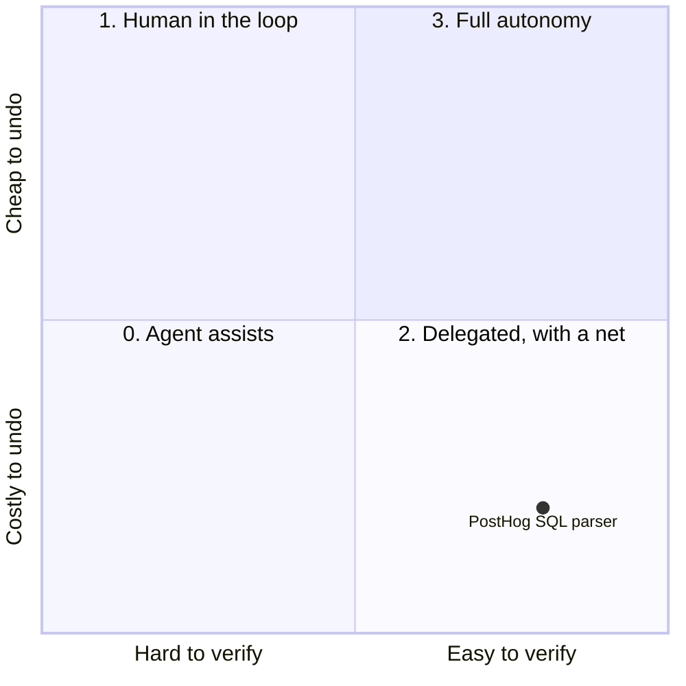
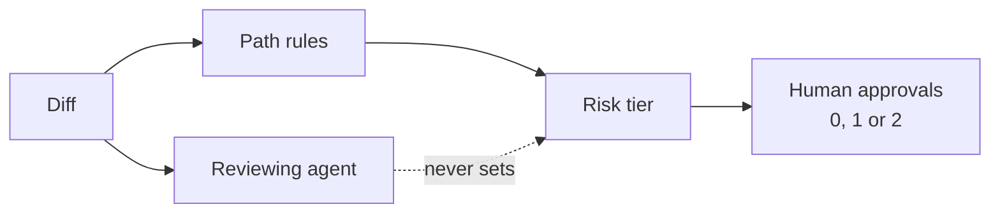
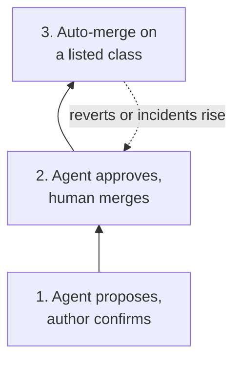

Every discussion about AI code review ends on the same question. If the bot reviews the PR, can the bot merge it?

My instinct was no, and since we have not tried it yet, I spent a few weeks reading to find out whether that instinct was just habit. It turns out the teams with the most volume have already answered, and the answer is more interesting than yes or no. They do let agents merge, under rules the agent had no part in writing.

## Trust belongs to the task

Jina Yoon at PostHog wrote the clearest framing I have read ([When to trust an agent](https://newsletter.posthog.com/p/agent-autonomy)). Trusting an agent more because the model got better is like skipping the seatbelt because you bought a nicer car. What matters is the task, and two questions are enough to classify it.

Is the work easy to verify with deterministic checks?

Is a mistake cheap to undo?

Her example is worth keeping. PostHog rewrote their SQL parser in Rust and barely read it line by line, because a mechanical oracle existed to check the output. But the parser sits under every query on the platform, so the rollout went through a shadow mode in production and a gradual switch. Easy to verify, expensive to undo, so level 2 with a net.

Auto-merge is level 3 only. Easy to verify and cheap to undo, which in practice means behind a feature flag with a rollback that takes minutes.

## Keep the classifier away from the reviewer

The obvious shortcut is to ask the reviewing agent whether the PR is safe to merge. Resist it.

First because an LLM judging its own category is exactly the setup that fails. JudgeBiasBench, a benchmark published in March ([arXiv 2603.08091](https://arxiv.org/abs/2603.08091)), injects twelve kinds of irrelevant cues into judging tasks. Current LLM judges show significant and diverse bias patterns across them, enough to compromise automated evaluation. A study on debiasing strategies from April ([arXiv 2604.23178](https://arxiv.org/abs/2604.23178)) finds style bias, such as preferring markdown over plain prose, far stronger than position bias.

Neither paper looks at code review. Both match what anyone who has watched a model grade its own homework already suspects, and that is enough for me to keep a lone LLM judge away from a production gate.

Second because the useful classification is mostly deterministic. Which paths did the diff touch? Does it change a migration, a payment flow, a permission check, a CI workflow file? Does it add code behind a flag or change existing behaviour? Those are rules. A path-based labeler answers them before any model runs.

Anthropic's Claude Code team, who now land more than 30,000 changes a day in their monorepo, sum it up in one rule ([How the Claude Code team does code review](https://claude.dev/blog/solving-code-review-at-anthropic/)): the change itself sets the risk tier, whoever wrote it.

In practice, a classifier picks the tier from the diff. A second classifier checks whether a person is needed anyway. Some paths always need one: areas listed as sensitive by their owners, and any CI workflow file.

| Risk | Examples | Human approvals |
|---|---|---|
| Low | Docs, copy, internal-only features, additive changes behind a flag | None, once automated and security checks are green |
| Medium | Ordinary product changes, plus sensitive areas like caching, the auto-updater, system prompts | One |
| High | The riskiest code, and paths that always need two people | Two |

Two more rules from the same post, which I think are the whole thing in miniature.

> An agent's approval never counts as a person's.

> An approval covers one specific commit.

A new push after approval is a new PR as far as the system is concerned. [Florian Bruniaux](https://florian.bruniaux.com) made the same point in his talk at Dev With AI in Paris this month, "Du code au merge": "A validated doesn't mean B validated." Tests and reviews attach to a commit. The conversation around the PR carries nothing.

## A ladder with three rungs

Put together, the teams I have read converge on a ladder. You climb it one rung at a time, and most teams should stop at the second.

**The agent proposes, the author confirms.** Deterministic labelling by path, then an agent that proposes a label and a one-line reason. The author of the PR confirms or overrides. Bruniaux runs this with two GitHub labels, Review AI and Review Human. Review AI is for a bounded, known change that tests can verify, inside a perimeter the team has authorised. Review Human is for access rights, private data, calculations, payments, or anything whose consequences are not well understood. When in doubt, ask for a human. The labels are a signpost for people and a filter for the bots.

**Auto-approve, human merges.** The agent review counts as an approval on low-risk PRs. A person still presses the button, which keeps ownership attached to a name. PostHog does a version of this with StampHog, a bot that approves low-risk PRs. The NextLevel case study collection on agentic code review ([source](https://agentic-code-review.netlify.app/)) covers eight organisations, and in every one of them a human still merges.

**Auto-merge on a listed class.** Docs, copy, dependency bumps with green CI, additive code behind a flag. The class is written down somewhere, and nothing outside the list qualifies. Only trusted authors, in practice the owning team, get the lighter path. And the guardrail is measured: if reverts or incidents go up, the lighter path closes.

Anthropic's post ends on something I find reassuring. They do not yet have the circuit breaker that tightens approval automatically when revert numbers rise, and their engineers want it before more code moves to zero-human merges. Even the team furthest along is not comfortable without it.

## What scales down

We are nowhere near 30,000 changes a day, and we have not climbed any of this ladder yet. What draws me to it is that the first rung costs almost nothing. A path-based labeler, two labels, and a short written perimeter that says which kinds of changes the team is willing to let a bot read alone.

The tooling is the easy half. Writing that perimeter down and agreeing on it takes a team conversation, and the next post is about what the bot does once it is inside the perimeter and finds something.
